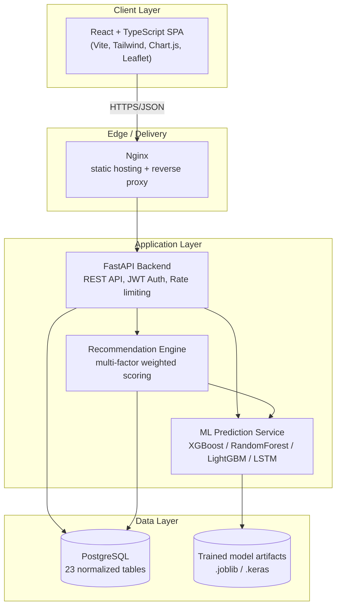
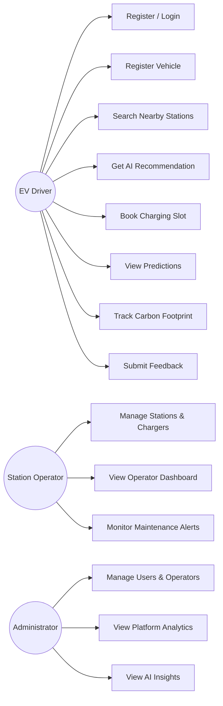
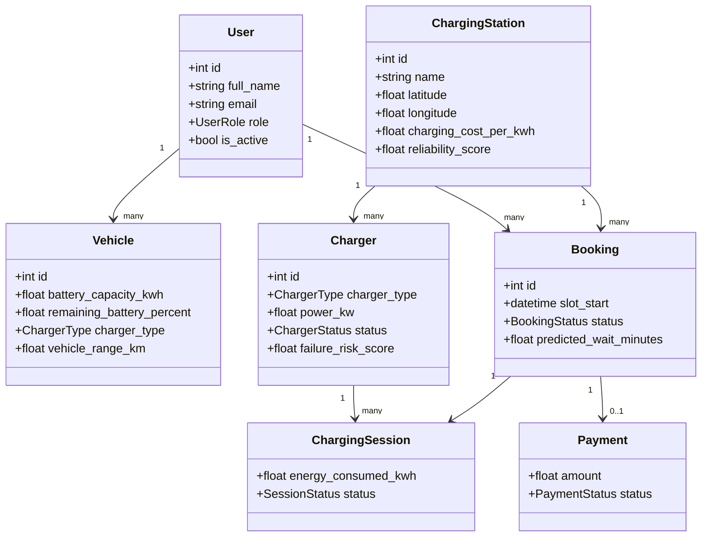
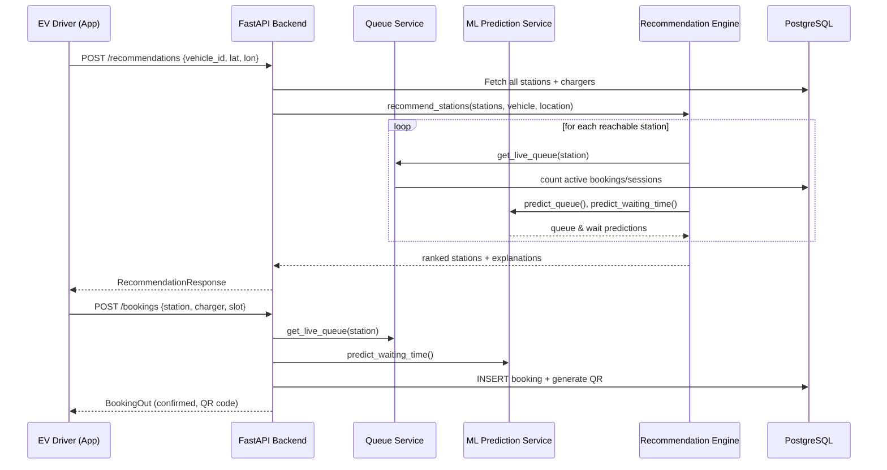
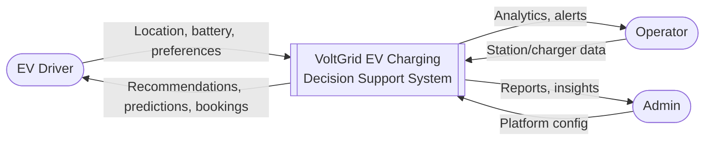
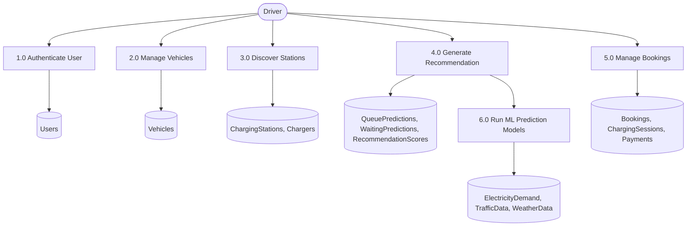
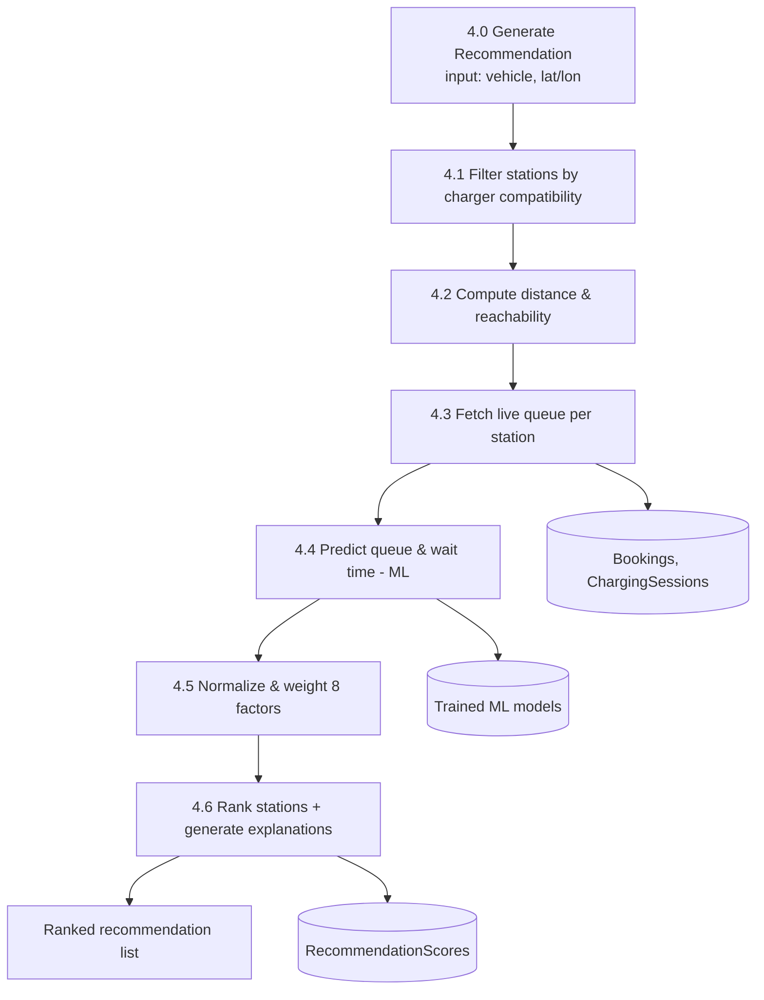
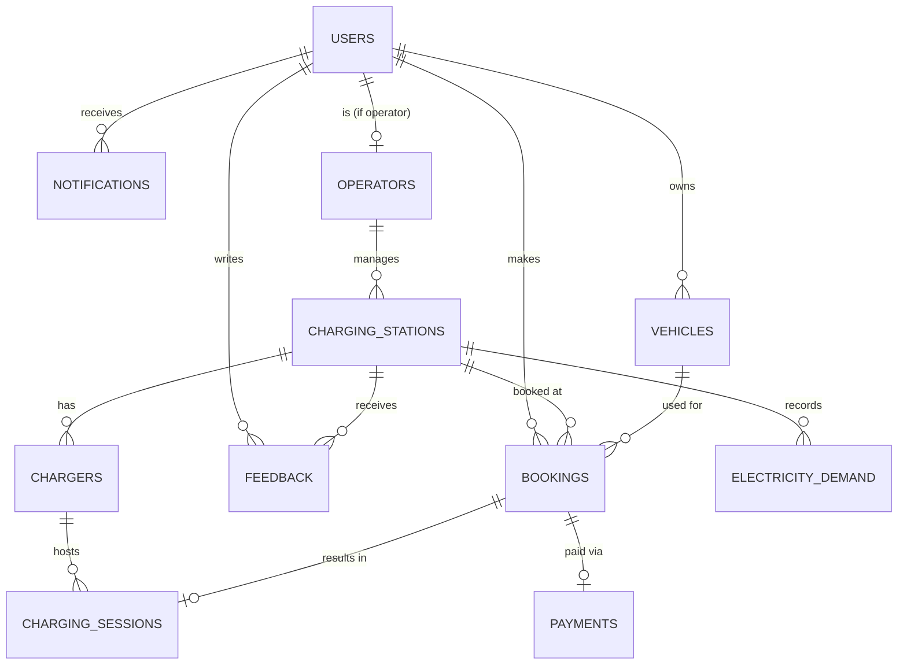

# System Architecture & Diagrams

All diagrams are written in [Mermaid](https://mermaid.js.org/) syntax. GitHub, GitLab, and most modern
Markdown viewers render these automatically. You can also paste any block into https://mermaid.live to view/export as an image.

---

## 1. System Architecture

---

## 2. Use Case Diagram

---

## 3. Class Diagram (core domain)

---

## 4. Sequence Diagram — Smart Recommendation & Booking Flow

---

## 5. Data Flow Diagram — Level 0 (Context)

---

## 6. Data Flow Diagram — Level 1

---

## 7. Data Flow Diagram — Level 2 (Recommendation subsystem)

---

## 8. Entity Relationship Diagram (summary)

For the full, versioned schema see [`database/schema.sql`](../database/schema.sql).
